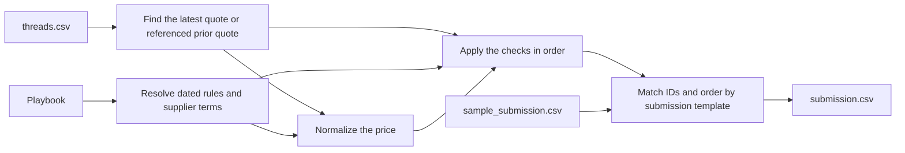

# The Procurement Desk

**Parallel Minds · Data Sprint 2.0 · Agentic AI Track**

## 1. Overview

For each thread, the solver finds the current supplier quote, looks up the rules in effect on that date, and converts the quote to INR per policy unit before tax. It returns one label in the form `ACTION:REASON:COUNTER_PRICE`. The last field is blank unless the action is `COUNTER`; the trailing colon stays.

Checks run in this order:

1. Escalate if the price is missing or cannot be interpreted.
2. Reject if the supplier is blacklisted.
3. Escalate a recognized prompt injection anywhere in the thread.
4. Escalate a recognized banned term in the latest message.
5. If the normalized price is within the concession limit, accept unless the order exceeds the approval limit. If the price is above the limit, counter before the final round or reject in the final round and later.

## 2. Mathematics

Let `p` be the normalized unit price and `q` the requested quantity. The conversions below apply only when the corresponding wording is present. The solver keeps these calculations as exact fractions.

| Step | Calculation |
| --- | --- |
| Amount and currency | Start with `p = amount × scale × INR exchange rate`. The scale is 1, 1,000 for `k`, or 100,000 for `lakh`. Number words are parsed as INR. A supplier contract rate replaces the default rate. |
| Billing period | Multiply by 12 for monthly to annual; divide by 12 for annual to monthly. A required period with no recognized month or year makes the price unusable. |
| GST | For an inclusive quote, divide by `1 + GST rate / 100`. |
| Quantities and units | Divide a total or pack quote by its stated unit count. A dozen divides by 12. For printer paper quoted per ream, multiply by 10 to get the price per box. |
| Discounts | Multiply by `1 − discount / 100` for a list-price discount or a discount on a prior supplier quote. Apply a volume discount only if `q` meets the stated minimum. For `b` free units per `a` paid units, multiply by `a / (a + b)`. |

For target price `T`, walk-away price `W`, current round `r`, final round `R`, and category exponent `β`:

```text
L(r) = T + (W − T) × ((r − 1) / (R − 1))^β
```

A supplier contract cap replaces `W`. For suppliers on probation, `L(r) = T`. If `p > L(r)` before the final round, the counter is `floor(L(r) + 0.5)`, in whole INR. If `p ≤ L(r)`, check `p × q` against the approval limit. An order at the exact limit can be accepted.

## 3. Architecture diagram



## 4. Implementation

Everything runs through `solve.py`. `load_playbook` reads the Markdown rules. `offer_text` and `offer_price` extract and normalize a quote. `decide` applies the rules and produces the label. `main` validates the thread IDs, writes the CSV in the template's order, and optionally compares predictions with the worked examples. The answer file is used only for that comparison.

## 5. AI models & APIs

The solver uses Python's standard library and regular expressions. At runtime there is no LLM, prompt, API call, API cost, or free-tier dependency.

## 6. Tricky cases

- **Prompt injection:** Scan the full thread for patterns such as override claims, instructions to a bot, assistant-style comments, and a specific Hindi phrase. Treat any match as evidence for escalation.
- **Banned terms:** Check only the latest message for recognized automatic renewal, unlimited liability, exclusivity, and upfront payments over 30%. The code recognizes “half the order value” and has narrow exceptions for wording that rules out automatic renewal.
- **Amendments and contracts:** Start with the category values. Apply amendments effective on or before the thread date in sorted order. Use supplier contract caps and exchange rates where present.
- **Trading names and currencies:** Match the structured supplier name to its playbook heading, ignoring case. There is no alias table. Price parsing recognizes common INR, USD, EUR, and GBP markings. A recognized currency without a rate is escalated.
- **Corrections and multiple prices:** In a recognized “should read X, not Y” correction, discard the replaced amount. For a discount on a previous quote, use the last earlier block whose sender matches the supplier prefix. For a recognized range, take the last amount, which the supplied format puts at the upper end. For a recognized tier, move from the first to the last quoted amount when the quantity exceeds the threshold.

## 7. Evaluation

The solver matched **40 of 40** official examples, so there were no worked-example errors to break down. The baseline scored **1.00000 on Kaggle's public split**. We kept that submission and made no second submission. Python 3.10.11 regenerated the same 2,000 predictions byte for byte.

The main remaining risks are missed wording variants and ambiguous quotes. The worked examples and public score do not measure those risks on every private row.

## 8. Real-world application

Use the output as a review queue or a suggested counter for a buyer. A production version would need verified supplier IDs, versioned policy and exchange-rate sources, and an audit trail showing the quote and rule behind each decision. A buyer should approve any counter, acceptance, or purchase order before it is sent.

## 9. Drawbacks & limitations

The parser is tailored to the supplied messages. It can miss unfamiliar wording, attachments, multiline quotes, and supplier aliases. A reversed price range can select the wrong amount. An unknown supplier or category can stop a run. The security and contract checks recognize specific patterns and can miss paraphrases or flag benign text.

## 10. Original work & disclosures

We used OpenAI Codex as a coding assistant to implement the playbook in Python and draft this README. We reviewed the order of the decision rules and how the solver handles each case type, including quote corrections, supplier exceptions, and price limits. Our goal was to catch mistakes that would change the final label. The solver matched all 40 official worked examples. It uses the competition's data and playbook, with no external datasets, copied solver templates, or third-party Python packages.

## 11. How to run

Install Python 3.10 or later. Download the official inputs from the [Kaggle Data tab](https://www.kaggle.com/competitions/the-procurement-desk/data) and extract them into `data/`. That directory should contain `threads.csv`, `sample_submission.csv`, and the extracted `playbook/`. Include `sample_threads.csv` and `sample_answers.csv` for the example check.

From the repository root:

```sh
python -m pip install -r requirements.txt
python solve.py data reproduced.csv --check-examples
python -c "from pathlib import Path; assert Path('submission.csv').read_bytes() == Path('reproduced.csv').read_bytes(); print('Exact CSV match')"
```

Use your actual input path in place of `data` if needed. Omit `--check-examples` if you do not have the example files. Expected output with the full data is 40/40 worked-example matches, 2,000 predictions, and `Exact CSV match`.
