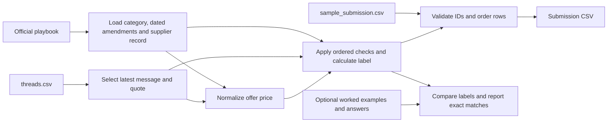

# The Procurement Desk

**Team:** Parallel Minds · **Event:** Data Sprint 2.0, Agentic AI Track

## 1. Overview

The solver reads each row's category, date, supplier, quantity, round, and email thread. It loads the matching playbook and supplier record, identifies the relevant quote, and converts the price to INR per policy unit before tax. It applies the rules in the order below and emits one label per thread.

| Priority | Condition | Action and reason |
| --- | --- | --- |
| 1 | The price is missing or unusable | `ESCALATE:MISSING_INFO` |
| 2 | The supplier is blacklisted | `REJECT:BLACKLISTED_SUPPLIER` |
| 3 | The thread matches a prompt injection pattern | `ESCALATE:PROMPT_INJECTION` |
| 4 | The latest message matches a banned term | `ESCALATE:BANNED_TERM` |
| 5 | The normalized price is within the concession limit but the order exceeds the approval limit | `ESCALATE:OVER_APPROVAL_LIMIT` |
| 6 | The normalized price and order value are within their limits | `ACCEPT:ACCEPTABLE_PRICE` |
| 7 | The normalized price exceeds the concession limit in the final round or later | `REJECT:ABOVE_WALKAWAY` |
| 8 | The normalized price exceeds the concession limit before the final round | `COUNTER:COUNTER_OFFER` at the rounded concession limit |

The CSV columns are `thread_id,label`. Each label has the format `ACTION:REASON:COUNTER_PRICE`. The last field is empty except for counters, and the trailing colon is still present.

## 2. Mathematics

Let $x$ be the quoted number, $e$ the INR conversion rate per currency unit, $q$ the requested quantity, and $p$ the normalized unit price. The factors below apply only when their corresponding pattern is present. The implementation uses Python's `Fraction` for exact arithmetic through the price comparison and counter rounding.

| Operation | Equation and interpretation |
| --- | --- |
| Currency and scale | Start with $p = x \times e \times s$. Here $s$ is 1, 1,000 for `k`, or 100,000 for `lakh`. A supplier contract rate overrides the base rate. Number words are converted to a numeric INR amount. |
| Billing period | $p \leftarrow 12p$ for monthly to annual, or $p \leftarrow p/12$ for annual to monthly. A category that requires a period is escalated when the parser finds none. |
| Tax | For an inclusive GST quote, $p \leftarrow p/(1+g/100)$, where $g$ is the category GST percentage. |
| Order total or pack | $p \leftarrow p/n$ for a total covering $n$ units or a recognized count per pack or quote. A dozen divides by 12. |
| Paper unit | $p \leftarrow 10p$ for a per-ream quote in the printer-paper category, whose policy unit is a box of 10 reams. |
| Percentage discount | $p \leftarrow p(1-d/100)$ for a list-price discount or a discount of $d$ percent on the supplier's prior quote. A volume discount applies only when $q$ is at least the stated minimum. |
| Free units | $p \leftarrow p\,a/(a+b)$ when $b$ units are free for every $a$ paid units. |
| Concession | With target $T$, walk-away price $W$, current round $r$, final round $R$, and category exponent $\beta$, the limit is $L(r)=T+(W-T)((r-1)/(R-1))^{\beta}$. A contract cap replaces $W$ for the applicable category. For a supplier on probation, $L(r)=T$. |
| Counter | For a nonfinal round with $p>L(r)$, the counter in whole INR is $\lfloor L(r)+1/2\rfloor$. |
| Approval | Check the order value $p \times q$ only when $p \le L(r)$. Escalate when it is strictly greater than the effective approval limit. Equality is allowed. |

For recognized tiered quotes, use the first amount through the stated upper quantity bound, and the last amount above that bound. For a recognized `between` range, use its last amount. That relies on the supplied format placing the upper end last.

## 3. Architecture diagram



## 4. Implementation

The submitted implementation is a single Python file, `solve.py`.

- `load_playbook` reads category values, dated amendments, supplier status and contract overrides, and exchange rates from official Markdown files.
- `offer_text`, `number_from_words`, and `offer_price` extract the quote and normalize its price. `banned_term` recognizes the contract language listed below.
- `decide` matches supplier and policy records, chooses which messages to inspect, applies rule precedence, computes the concession limit, and constructs the label.
- `main` optionally evaluates worked examples, validates the generated ID set against the 2,000 unique template IDs, and writes predictions in the template's order. The answers are used only by the optional evaluation.

## 5. AI models & APIs

All runtime decisions use deterministic Python code and regular expressions. There are no runtime models, prompts, API calls, API costs, credentials, or free-tier requirements. OpenAI Codex assisted in writing the solver and checking its output during development. Supplier text is never executed or sent to a model by the solver.

## 6. Tricky cases

| Case | What the code does |
| --- | --- |
| Prompt injection | Checks the full thread after the price and blacklist gates. The patterns cover examples such as override claims, instructions to a bot, assistant-looking comments, and a specific Hindi instruction. Matching text triggers an escalation. |
| Banned terms | Scans the latest message line by line for recognized auto-renewal phrases, unlimited liability, exclusivity, and advance or upfront payments over 30%. The phrase “half the order value” counts as 50%. There are narrow exceptions for explicit renewal negation or mutual agreement wording. |
| Dated amendments | Applies changes in sorted order when their effective date is on or before the thread date. Initial settings come from the category. |
| Supplier contracts | Uses the contract cap in place of the category walk-away price when present, and merges contract FX rates over the default rates. |
| Trading names | Uses the structured supplier column and matches it case-insensitively to the playbook supplier heading. The implementation has no separate alias table or fuzzy trading-name matching. |
| Currencies | Recognizes INR and its common markers, plus USD, EUR, and GBP with rates from the playbook. A recognized currency with no rate, or an unparseable quote, triggers missing information. |
| Corrections and earlier quotes | Uses the latest tagged message, or the whole message for a standalone quote. A recognized “should read X, not Y” correction discards the old amount. When an offer references a percentage off a prior quote, the code finds the last earlier block with a matching supplier prefix and applies the discount to that normalized amount. |
| Multiple prices | Uses the last amount for recognized ranges, selects a tier using quantity, and otherwise uses the first recognized amount on the quote line. Handles supported pack, free-unit, and volume wording as described above. |

## 7. Evaluation

- **Worked examples:** 40 of 40 exact matches with `--check-examples`. There were no mismatches to analyze on that set. The classifier has clearly defined failure modes for unfamiliar phrasing and inputs, described under limitations.
- **Kaggle public score:** 1.00000 for the first submission, “Playbook solver baseline.” This score applies to the public split. We did not use hidden labels to estimate accuracy.
- **Submission changes:** This repository packages that baseline. No second submission or post-submission prediction changes were made in this workflow.
- **Reproduction:** Python 3.10.11 generated 2,000 rows and reproduced the preserved submission byte for byte. Its SHA-256 is `e7cb2ed18e971f21fcc2766a2b9fa02b059daf303a5e1c38005cf1355aaa7d98`.

## 8. Real-world application

A procurement team could use this approach to triage well-formed quotes and prepare proposed decisions for approval. In production, use verified supplier IDs, approved and versioned policy and exchange-rate sources, a trusted message parser, role-based access, and an audit record explaining each decision. Route ambiguous terms and flagged input for human review. Require authorized approval before sending a counter, accepting an offer, or creating a purchase order.

## 9. Drawbacks & limitations

The quote parser is tuned to the supplied email templates. Unseen languages, reordered price ranges, multiline quotes, attachments, ambiguous contract language, alias-only names, and new units can yield missed or incorrect decisions. An unknown supplier or category can raise an error. Pattern-based security and legal checks can miss paraphrases or flag benign language. The date logic assumes comparable ISO-format dates. The tool writes CSV predictions and is not designed to autonomously negotiate or approve real purchases.

## 10. Original work & disclosures

This entry consists of the team-specific Python parser and ordered decision rules built for the competition with OpenAI Codex assistance. It uses the organizers' playbook, official input CSVs, and worked examples. No third-party runtime libraries, external datasets, or copied solver templates are used. The submitted prediction file was generated by the solver.

## 11. How to run

1. Install Python 3.10 or newer. Python 3.10.11 was used for reproduction. `requirements.txt` lists the dependency policy. No packages are required.
2. Obtain the official files from [the competition Data tab](https://www.kaggle.com/competitions/the-procurement-desk/data). Extract them into a local directory called `data`. It must contain `threads.csv`, `sample_submission.csv`, and `playbook/` (either the direct policy folders or an extra nested `playbook/`). Add `sample_threads.csv` and `sample_answers.csv` to run the worked examples. The official input data is kept separate from the repository.
3. From the repository root, run the following commands. Use your real dataset path instead of `data` if your inputs are stored elsewhere. Omit `--check-examples` if you only have the prediction inputs.

   ```sh
   python -m pip install -r requirements.txt
   python solve.py data reproduced.csv --check-examples
   python -c "from pathlib import Path; assert Path('submission.csv').read_bytes() == Path('reproduced.csv').read_bytes(); print('Exact CSV match')"
   ```

   Expected result with the original inputs: 40/40 exact example matches, 2,000 output rows, and `Exact CSV match`.
